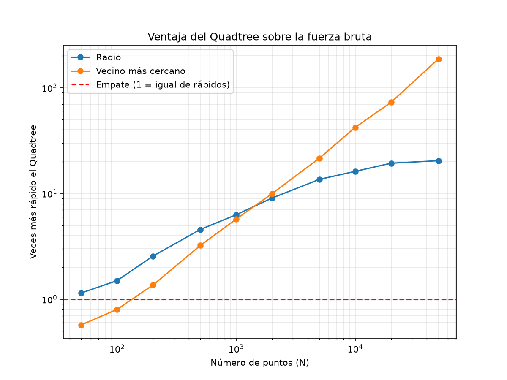
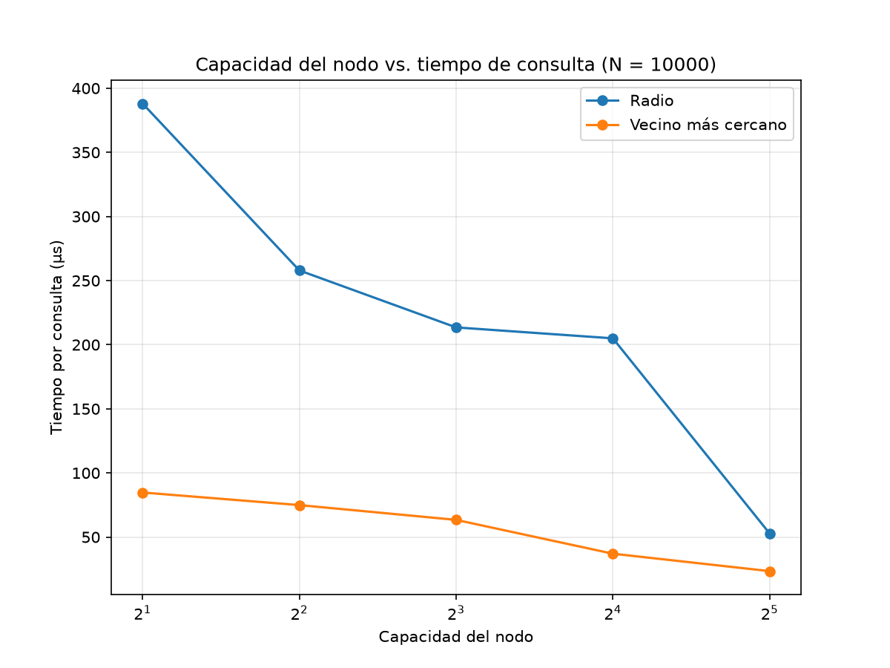
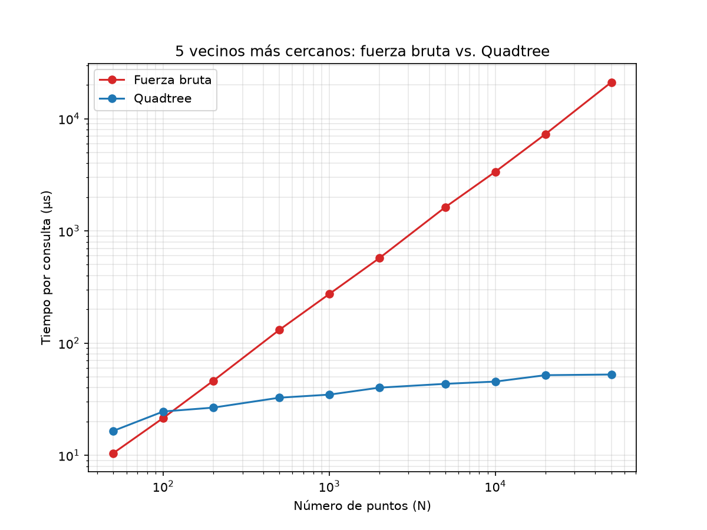
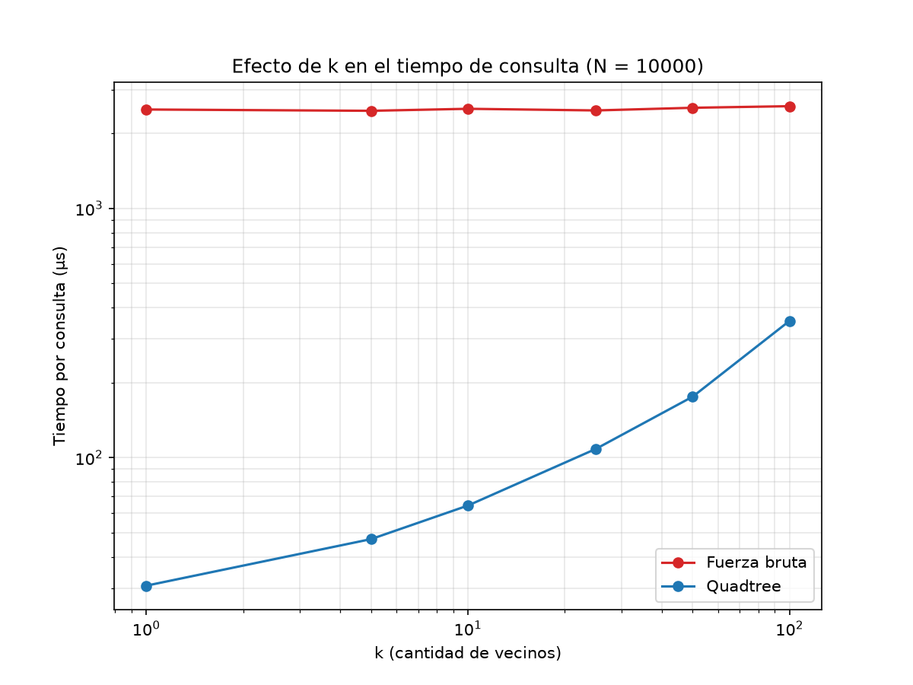

# Búsqueda espacial de entregas con un Quadtree

Este laboratorio 4 de estructura de datos estudia cómo localizar puntos de entrega en una ciudad de 10.000 × 10.000 metros. Con 10.000 ubicaciones estáticas generadas con `random.seed(42)`, se comparan tres consultas bidimensionales —puntos dentro de 500 m, vecino más cercano y k vecinos más cercanos— mediante un Quadtree implementado desde cero y una búsqueda por fuerza bruta.

## Codigo de Honor

parte de este readme, la elaboracion del codigo de las graficas test y analisis esta hecho con Inteligencia Artificial (Claude), un poco con la fierza bruta pero el quadtree esta realizado mediante apuntes mios y sugerencias que me daba la IA la elaboración es mia, las pruebas, verificación y todo fue corrido en mi computadora y lo revise.

## Estructura del repositorio

| Archivo o carpeta | Contenido |
|---|---|
| [Quadtreetree.py](./Quadtreetree.py) | Rectángulos, Quadtree, consultas espaciales y funciones de referencia por fuerza bruta. |
| [test.py](./test.py) | Seis pruebas unitarias y generación de gráficas de verificación. |
| [analisis.py](./analisis.py) | Mediciones de rendimiento, experimentos de capacidad y k vecinos. |
| [graficas/](./graficas/) | Gráficas generadas por las pruebas y el análisis. |

## Requisitos y ejecución

Se requiere Python 3 y `matplotlib`. Para instalar la dependencia:

```bash
pip install matplotlib
```

Desde la raíz del repositorio se pueden ejecutar:

```bash
python test.py
```

Ejecuta las seis pruebas unitarias y genera las gráficas de verificación en `graficas/`.

```bash
python analisis.py
```

Mide los tiempos para distintos tamaños de datos, compara capacidades y evalúa búsquedas de k vecinos. El análisis completo tarda varios minutos.

## Planteamiento de la solución

1. **Fuerza bruta como referencia.** Para cada consulta se recorren los puntos y se comparan distancias al cuadrado. Para el radio se acepta un punto cuando `d² <= r²`, evitando calcular raíces cuadradas durante la comparación. Las funciones de referencia están en `Quadtreetree.py`.
2. **Rectángulos de límites.** `Rect` se define por el centro `(dx, dy)` y las semimedidas `w` y `h`. `contains` comprueba si un punto está dentro; `min_dist2` limita cada coordenada de la consulta a los bordes para hallar la distancia al cuadrado mínima al rectángulo; `intersects_circle` usa esa distancia mínima para decidir si el círculo lo toca.
3. **Construcción del Quadtree.** Cada nodo admite hasta `capacity` puntos (4 por defecto). Al intentar insertar uno más, se divide en cuatro rectángulos de la mitad del tamaño, se crean los hijos NO, NE, SO y SE y se redistribuyen los puntos. Una hoja no tiene hijos y almacena sus puntos (puede quedar vacía si no hay puntos en ese cuadrante); un nodo interno tiene cuatro hijos y no conserva puntos propios.

```text
División de un rectángulo:          Estructura del árbol:
┌───────────┬───────────┐                 Nodo
│    NO     │    NE     │             /   |   |   \
├───────────┼───────────┤           NO   NE  SO   SE
│    SO     │    SE     │           (cada hijo puede subdividirse)
└───────────┴───────────┘
```

4. **Búsqueda por radio.** Si el círculo no intersecta el rectángulo de un nodo, se descarta ese nodo junto con toda su rama. Si lo intersecta, se revisan sus puntos y se continúa recursivamente con sus hijos.
5. **Vecino más cercano.** Se mantiene el mejor candidato y su distancia al cuadrado. Se descarta un nodo cuando su rectángulo no puede mejorar al candidato actual; los hijos se visitan desde el rectángulo más cercano al más lejano.
6. **k vecinos más cercanos.** Se mantiene una lista ordenada de hasta `k` candidatos. Cuando ya contiene `k` puntos, se descarta un nodo si su rectángulo está más lejos que el peor candidato. Con `k = 1`, la búsqueda equivale al vecino más cercano.
7. **Verificación y medición.** Las pruebas comparan los resultados del árbol con los de fuerza bruta. Las gráficas ilustran esas consultas; el análisis mide los tiempos para distintos tamaños y capacidades.

### Gráficas de verificación

| Imagen | Contenido |
|---|---|
| [resultado_radio.png](./graficas/resultado_radio.png) | Consulta de radio de 500 m sobre los puntos de entrega. |
| [comparacion_metodos.png](./graficas/comparacion_metodos.png) | La misma consulta por fuerza bruta y Quadtree; ambos encuentran 69 puntos. |
| [vecino.png](./graficas/vecino.png) | Vecino más cercano a 31,6 m; el círculo de ese radio no contiene otros puntos. |
| [k_vecinos.png](./graficas/k_vecinos.png) | Cinco vecinos a 32, 74, 94, 103 y 131 m, ordenados por distancia. |

## Verificación

`python test.py` ejecuta seis pruebas. Todas terminan en OK:

| Prueba | Verificación |
|---|---|
| Conteo | El Quadtree contiene los 10.000 puntos. |
| Radio en el centro | La consulta de 500 m en `(5000, 5000)` devuelve 69 puntos, iguales a los de fuerza bruta. |
| Radios aleatorios | 100 consultas aleatorias devuelven los mismos puntos con ambos métodos. |
| Vecino aleatorio | En 100 consultas aleatorias coincide el punto más cercano. |
| Sin resultados | Un círculo diminuto sin puntos devuelve una lista vacía. |
| Cinco vecinos aleatorios | En 100 consultas aleatorias coinciden los cinco puntos más cercanos y su orden. |

Las pruebas generan los 10.000 puntos con `random.seed(42)` y abarcan el dominio de 0 a 10.000 metros en cada coordenada.

## Análisis de rendimiento

Los tiempos por consulta se obtuvieron con `time.perf_counter`: se promediaron 200 consultas aleatorias por tamaño, se repitió cada medición tres veces y se conservó el menor valor. El barrido completo también se repitió tres veces y se tomó el mejor valor de cada punto para reducir el ruido. Para las mediciones del análisis se usa `random.seed(1)`. Las gráficas usan ejes logarítmicos: una recta ascendente representa crecimiento lineal y una línea casi plana indica que el tiempo cambia poco con `N`.

### Radio y vecino más cercano

| N | Construcción (ms) | Radio bruta (µs) | Radio árbol (µs) | Vecino bruta (µs) | Vecino árbol (µs) |
|---:|---:|---:|---:|---:|---:|
| 50 | 0,06 | 7,4 | 6,5 | 6,2 | 10,8 |
| 100 | 0,15 | 14,3 | 9,5 | 12,3 | 15,4 |
| 200 | 0,32 | 28,6 | 11,2 | 23,5 | 17,2 |
| 500 | 1,02 | 79,7 | 17,4 | 61,7 | 19,1 |
| 1.000 | 2,15 | 144,0 | 22,9 | 117,2 | 20,5 |
| 2.000 | 4,59 | 307,0 | 33,9 | 238,4 | 23,9 |
| 5.000 | 13,06 | 756,5 | 55,6 | 601,8 | 27,9 |
| 10.000 | 27,95 | 1499,5 | 92,6 | 1216,6 | 28,9 |
| 20.000 | 65,19 | 3098,2 | 160,3 | 2450,4 | 33,7 |
| 50.000 | 214,88 | 7812,3 | 382,5 | 6152,6 | 32,9 |

| Gráfica | Contenido |
|---|---|
| [analisis_radio.png](./graficas/analisis_radio.png) | Tiempo de consulta por radio. |
| [analisis_vecino.png](./graficas/analisis_vecino.png) | Tiempo de consulta del vecino más cercano. |
| [analisis_construccion.png](./graficas/analisis_construccion.png) | Tiempo de construcción del Quadtree. |

El vecino más cercano favorece a la fuerza bruta con `N = 100` (12,3 frente a 15,4 µs), pero favorece al árbol con `N = 200` (17,2 frente a 23,5 µs): el cruce está entre 100 y 200 puntos. Para el radio, el árbol ya resulta más rápido en `N = 50` (6,5 frente a 7,4 µs), aunque la diferencia es mínima y puede ser ruido; desde `N = 100` la ventaja es clara. Para `k = 5`, el cruce también está entre 100 y 200 puntos.

### Ventaja del árbol

La gráfica de ventaja muestra cuántas veces es más rápido el árbol; la línea roja punteada en 1 marca el empate.



| N | Radio | Vecino más cercano | 5 vecinos |
|---:|---:|---:|---:|
| 1.000 | ~6 veces | ~6 veces | ~8 veces |
| 10.000 | ~16 veces | ~42 veces | ~74 veces |
| 50.000 | ~20 veces | ~187 veces | ~403 veces |

Las curvas de radio y vecino más cercano se cruzan entre `N = 1.000` y `N = 2.000`. El tiempo del árbol para el vecino y los k vecinos casi no crece con `N`. En el radio, la ventaja aumenta más despacio: la ciudad mantiene su tamaño y, al crecer la cantidad de puntos, el círculo de 500 m abarca más ubicaciones —unos 390 con `N = 50.000`— que deben devolverse.

### Costo de construcción y capacidad

La construcción tarda unos 28 ms con `N = 10.000` y unos 215 ms con `N = 50.000`, algo más que un crecimiento lineal. La fuerza bruta no requiere construir un índice; con `N = 10.000`, el costo del árbol se amortiza tras unas 20 consultas de radio o unas 24 de vecino más cercano.

Para `N = 10.000`, la comparación de capacidades fue:

| Capacidad | Construcción (ms) | Radio (µs) | Vecino (µs) |
|---:|---:|---:|---:|
| 2 | 36,10 | 155,1 | 33,1 |
| 4 | 28,24 | 96,8 | 29,9 |
| 8 | 24,31 | 74,0 | 26,7 |
| 16 | 20,34 | 52,2 | 22,5 |
| 32 | 20,72 | 54,2 | 22,3 |



Las capacidades de 16 a 32 resultaron las más rápidas, con menos niveles y menos llamadas recursivas. El resto del análisis usa la capacidad predeterminada de 4.

### Búsqueda de k vecinos

Para `k = 5`, los tiempos por consulta fueron:

| N | Fuerza bruta (µs) | Quadtree (µs) |
|---:|---:|---:|
| 50 | 10,5 | 16,5 |
| 100 | 21,5 | 24,6 |
| 200 | 46,2 | 26,6 |
| 500 | 131,1 | 32,6 |
| 1.000 | 273,9 | 34,7 |
| 2.000 | 571,4 | 40,1 |
| 5.000 | 1628,7 | 43,4 |
| 10.000 | 3366,7 | 45,4 |
| 20.000 | 7270,3 | 51,8 |
| 50.000 | 21152,9 | 52,5 |



Con `N = 10.000`, el efecto de variar `k` fue:

| k | Fuerza bruta (µs) | Quadtree (µs) | Ventaja |
|---:|---:|---:|---:|
| 1 | 3403,3 | 29,6 | ~115 veces |
| 5 | 3468,8 | 44,9 | ~77 veces |
| 10 | 3412,9 | 59,7 | ~57 veces |
| 25 | 3372,7 | 97,0 | ~35 veces |
| 50 | 3439,3 | 161,1 | ~21 veces |
| 100 | 3446,8 | 329,9 | ~10 veces |



La fuerza bruta mantiene un costo similar al variar `k`, porque ordena todos los puntos. El costo del Quadtree aumenta con `k`, ya que explora una zona mayor y descarta menos ramas; incluso con `k = 100` conserva una ventaja de unas 10 veces.

## Conclusiones

- En las mediciones, el Quadtree supera a la fuerza bruta desde alrededor de 100 a 200 puntos; la ventaja crece con `N`.
- La estructura es especialmente eficiente para el vecino más cercano y para pocos vecinos, porque puede descartar cuadrantes completos.
- La ventaja disminuye al aumentar `k`, pero se mantiene incluso para `k = 100`.
- La construcción tiene un costo inicial, que con `N = 10.000` se amortiza tras unas decenas de consultas.
- La capacidad del nodo influye en el rendimiento: las capacidades de 16 a 32 resultaron más rápidas que las de 2 a 4 en el experimento realizado.


